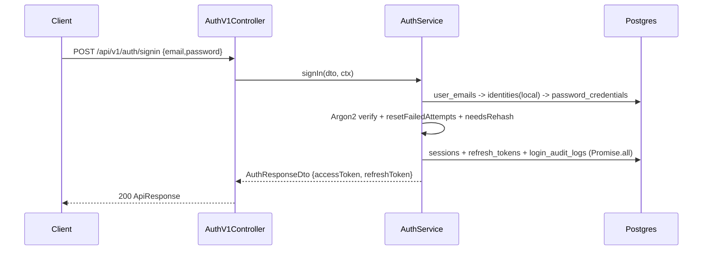
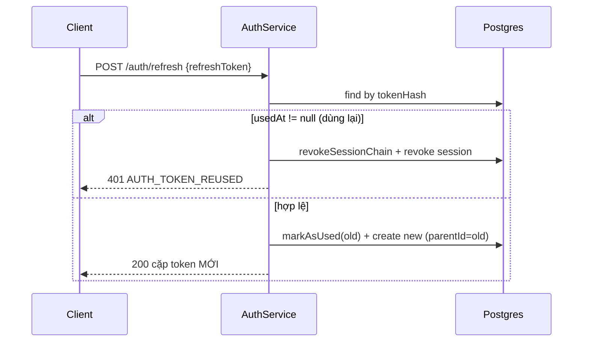
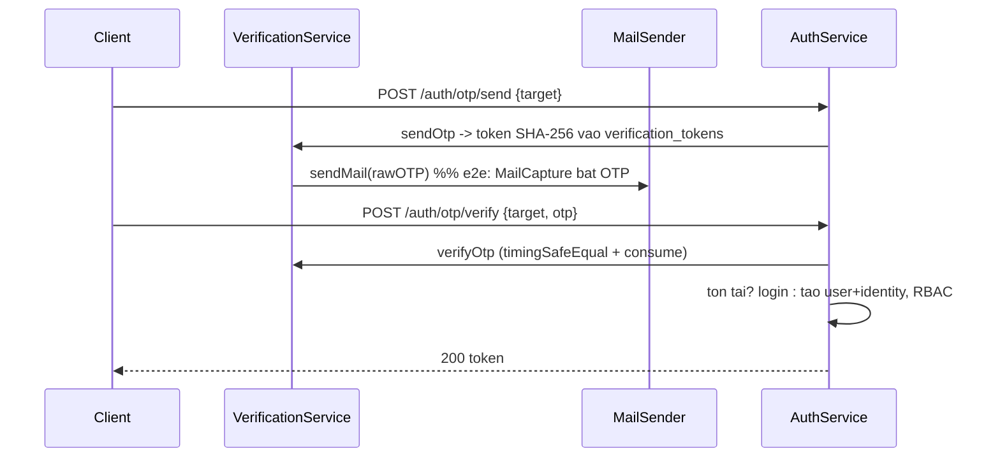
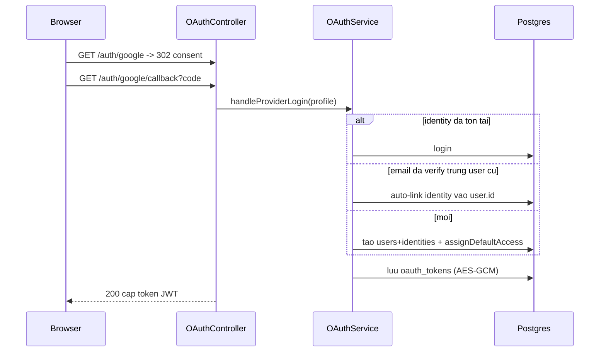
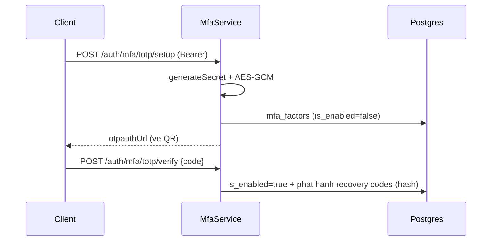
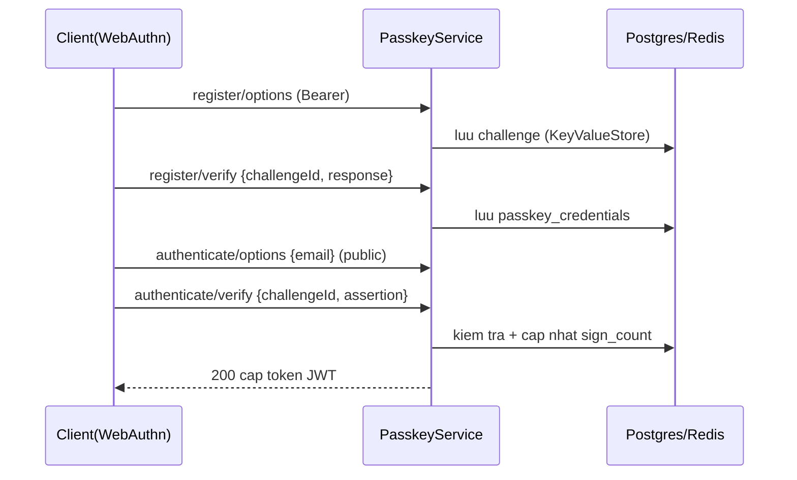
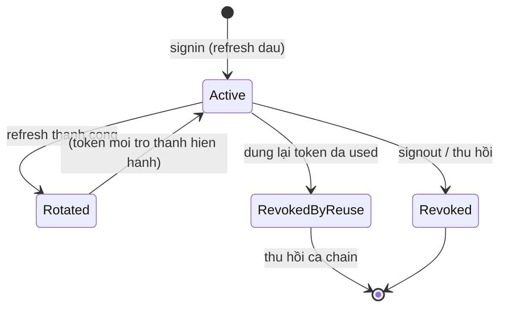
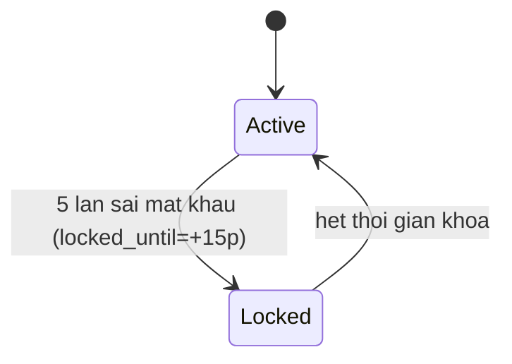
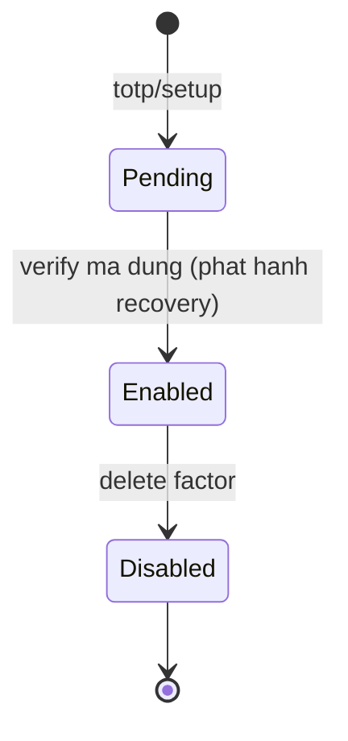

# ARCHITECTURE — Dịch vụ Xác thực & Phân quyền (Authentication Service)

> Tài liệu tham chiếu kiến trúc cho phân hệ `authentication/`. Mô tả **kiến trúc tầng**,
> **bản đồ module**, **vòng đời một request**, **lược đồ CSDL 21 bảng** (kèm sơ đồ ER Mermaid),
> **thiết kế từng phân hệ xác thực** (Password/OTP/Magic Link/Email Verification/OAuth/MFA/Passkey/RBAC),
> **mô hình bảo mật**, và **hướng dẫn mở rộng tích hợp**.
>
> - Đọc song song với [`API_GUIDE.md`](./API_GUIDE.md) (đặc tả endpoint & tích hợp client).
> - Tech stack: **NestJS 12 + TypeORM + PostgreSQL/MySQL (đa hình) + Argon2id/Bcrypt + JWT + otplib + @simplewebauthn + @nestjs/throttler**.

---

## Mục lục

1. [Tổng quan & nguyên tắc thiết kế](#1-tổng-quan--nguyên-tắc-thiết-kế)
2. [Kiến trúc tầng (Layered Architecture)](#2-kiến-trúc-tầng-layered-architecture)
3. [Bản đồ module & Dependency Injection](#3-bản-đồ-module--dependency-injection)
4. [Vòng đời một request (Request Lifecycle)](#4-vòng-đời-một-request-request-lifecycle)
5. [Mô hình Đa hình (Polymorphism / Strategy Pattern)](#5-mô-hình-đa-hình-polymorphism--strategy-pattern)
6. [Lược đồ CSDL: 21 bảng](#6-lược-đồ-csdl-21-bảng)
7. [Quan hệ giữa các bảng & Sơ đồ ER](#7-quan-hệ-giữa-các-bảng--sơ-đồ-er)
8. [Thiết kế các phân hệ xác thực](#8-thiết-kế-các-phân-hệ-xác-thực)
9. [Mô hình bảo mật](#9-mô-hình-bảo-mật)
10. [Cấu hình runtime & Đa hình hạ tầng](#10-cấu-hình-runtime--đa-hình-hạ-tầng)
11. [Hướng dẫn mở rộng & tích hợp](#11-hướng-dẫn-mở-rộng--tích-hợp)
12. [Quy mô horizontal & checklist production](#12-quy-mô-horizontal--checklist-production)
13. [Bản đồ kiểm thử](#13-bản-đồ-kiểm-thử)
14. [Decision Log (ADR)](#14-decision-log-adr)
15. [Sơ đồ tuần tự các luồng xác thực](#15-sơ-đồ-tuần-tự-các-luồng-xác-thực)
16. [Sơ đồ trạng thái (Session / Khóa / MFA)](#16-sơ-đồ-trạng-thái-session--khóa--mfa)
17. [Từ điển dữ liệu theo cột](#17-từ-điển-dữ-liệu-theo-cột)
18. [Danh mục sự kiện kiểm toán](#18-danh-mục-sự-kiện-kiểm-toán-auditeventtype)
19. [Khả quan & đo lường (Observability)](#19-khả-quan--đo-lường-observability)
20. [Danh mục mã lỗi](#20-danh-mục-mã-lỗi-errorcodes)
21. [Tài liệu & liên kết chéo](#21-tài-liệu--liên-kết-chéo)

---

## 1. Tổng quan & nguyên tắc thiết kế

Dịch vụ cung cấp **danh tính tập trung (Unified Identity)** và **phân quyền** cho toàn hệ sinh thái
`agent-cloud`. Một người dùng là **một `UserEntity` duy nhất**; mọi phương thức đăng nhập
(mật khẩu, OTP, Magic Link, Google, GitHub, Passkey) đều là một `UserIdentity` trỏ về cùng user đó.

Nguyên tắc cốt lõi (SOLID + 12-Factor):

| Nguyên tắc | Cách áp dụng trong mã nguồn |
|---|---|
| **Dependency Inversion** | Tầng service/repo chỉ phụ thuộc **interface** (`core/interfaces/`) qua **Symbol token** (`INJECTION_TOKENS`), không phụ thuộc class cụ thể. |
| **Open/Closed (Đa hình)** | Đổi engine mà **không sửa business logic**: DB (Postgres/MySQL), Hasher (Argon2/Bcrypt), Mail (Console/SMTP), OTP strategy (Numeric/MagicLink). |
| **Template Method** | `BaseAuthController` / `BaseAuthService` định khung; controller theo version (V1/V2) kế thừa và override tự do → **API Versioning không phá vỡ client cũ**. |
| **Boundary = Interface** | `src/core/` = trung tâm (abstract, interface, token); `modules/`, `repositories/`, `entities/` là vệ tinh phụ thuộc vào `core/`. |
| **Fail fast + cấu hình hóa** | `ConfigModule` validate bằng **Joi** ngay lúc boot; mọi hành vi bật/tắt qua biến môi trường. |
| **Bảo mật mặc định** | Không bao giờ lưu secret dạng thô (mật khẩu băm, OTP/link/refresh hash SHA-256, TOTP secret & OAuth token mã hóa AES-256-GCM). |

---

## 2. Kiến trúc tầng (Layered Architecture)

```
┌──────────────────────────────────────────────────────────────────────┐
│  PRESENTATION (modules/auth/controllers, oauth, mfa)                  │
│  Controller V1/V2  +  DTO (class-validator)  +  Swagger decorators    │
│  ApiResponse<T> / ApiErrorResponse chuẩn hóa                          │
└───────────────────────────────▲────────────────────────────────────────┘
                                 │ phụ thuộc vào INTERFACE
┌───────────────────────────────┴────────────────────────────────────────┐
│  APPLICATION / DOMAIN (modules/*.service)                               │
│  AuthService · OAuthService · MfaService · PasskeyService ·             │
│  VerificationService · RbacService · JwtTokenService · PasswordHasher   │
│  BaseAuthService (Template Method)                                      │
└───────────────────────────────▲────────────────────────────────────────┘
                                 │
┌───────────────────────────────┴────────────────────────────────────────┐
│  INFRASTRUCTURE (repositories, strategies, utils)                       │
│  *Repository (TypeORM) · DatabaseStrategy · MailStrategy · OtpStrategy  │
│  AesGcmCipher (crypto.util) · port.util                                 │
└───────────────────────────────▲────────────────────────────────────────┘
                                 │
┌───────────────────────────────┴────────────────────────────────────────┐
│  PERSISTENCE — Entities (21 bảng) trên PostgreSQL / MySQL               │
└──────────────────────────────────────────────────────────────────────────┘
```

- `src/common/` — hằng số, decorator, guard, exception, filter, response DTO, utils (cross-cutting).
- `src/core/` — **trung tâm hợp đồng**: `interfaces/`, `abstracts/`, `tokens/`. Không phụ thuộc tầng nào khác.
- `src/config/` — `ConfigModule`, `DatabaseModule` (factory đa hình), `IdentityModule` (đăng ký 21 entity).

---

## 3. Bản đồ module & Dependency Injection

| Module | Vai trò | Provider chính | Phụ thuộc (import) |
|---|---|---|---|
| **AppModule** | Gốc: config, DB, identity, auth, throttle toàn cục | `APP_GUARD: ThrottlerGuard` | Config, Database, Identity, Auth, Throttler |
| **AuthModule** | Điều phối xác thực + controllers | `AuthService`, `OAuthService`, `MfaService`, `PasskeyService`, Google/GitHub strategies & guards | Hashing, Token, Rbac, Repository, Notification, Verification, Passport |
| **HashingModule** | Băm mật khẩu đa hình | `PasswordHasherService` → `PASSWORD_HASHER` | Config |
| **TokenModule** | JWT + refresh rotation | `JwtTokenService` → `TOKEN_SERVICE`, `JwtStrategy` | JwtModule, Config |
| **RbacModule** | Roles & Permissions (RBAC + PBAC) | `RbacService` → `RBAC_SERVICE` (kèm cache TTL) | Repository |
| **RepositoryModule** | 15 repository TypeORM + ánh xạ token | `*Repository` | TypeOrm `forFeature` |
| **NotificationModule** | Gửi mail đa hình Console/SMTP | `MailSenderService` → `MAIL_SENDER` | Config |
| **VerificationModule** | OTP / MagicLink / Email-Verification | `VerificationService` → `OTP_SERVICE` | Repository, Notification |
| **DatabaseModule** | Chọn chiến lược DB lúc boot | `DatabaseConfigFactory` (Postgres/MySQL) | Config |
| **IdentityModule** | Đăng ký toàn bộ 21 entity | — | TypeOrm `forFeature` |
| **RedisModule** (global) | Cache/luu tru chia se, bat bang `ON_REDIS` | `CACHE_STORE` (InMemory/Redis), `REDIS_CLIENT`, `RedisThrottlerStorage` | ConfigModule, ioredis |

**Symbol token (`INJECTION_TOKENS`)** là "hợp đồng" giữa các tầng: controller/service nhận
`@Inject(INJECTION_TOKENS.X)` chứ **không** new class cụ thể → thay implementation mà không đụng call-site.

---

## 4. Vòng đời một request (Request Lifecycle)

```
Client → /api/v{n}/auth/...
   │
   ├─(1) ThrottlerGuard (APP_GUARD)   → chặn brute-force theo IP (@Throttle override theo endpoint)
   ├─(2) GlobalPrefix + URI Versioning→ /api + v{n}  (V1 / V2 cùng kế thừa BaseAuthController)
   ├─(3) Guard của endpoint           → JwtAuthGuard (@Public bỏ qua) → PermissionsGuard → RolesGuard
   ├─(4) ValidationPipe (global)      → whitelist + forbidNonWhitelisted + transform; lỗi → ValidationException
   ├─(5) Controller (kế thừa Base)    → getClientContext(req): ip (X-Forwarded-For), User-Agent, deviceName
   ├─(6) Service (polymorphic)        → điều phối repos + RBAC + Token + Mail/OTP (Promise.all tối ưu)
   ├─(7) Repository (TypeORM)         → Parameterized query, index scan
   ├─(8) Trả ApiResponse<T> { success, data, timestamp }
   └─(x) GlobalExceptionFilter        → mọi lỗi → ApiErrorResponse { success:false, error:{code,message,details}, timestamp }
```

- **Ngữ cảnh máy khách**: `getClientContext()` luôn ưu tiên `X-Forwarded-For` (reverse proxy/Nginx/Cloudflare),
  fallback `req.socket.remoteAddress`; IP + UA được ghi vào `sessions` và `login_audit_logs`.
- **Hợp đồng controller**: `IAuthController`; **hợp đồng service**: `IAuthService` — cả hai đều được
  `BaseAuthController` / `BaseAuthService` hiện thực một phần, phiên bản mới chỉ override endpoint cần thiết.

---

## 5. Mô hình Đa hình (Polymorphism / Strategy Pattern)

Mọi điểm dễ biến đổi đều được "cắm" qua Strategy + Token. Đổi bằng biến môi trường, **không sửa code**:

| Trục đa hình | Interface / Abstract | Implementation | Bộ chọn |
|---|---|---|---|
| CSDL | `DatabaseStrategyInterface` | `PostgresDatabaseConfigStrategy`, `MysqlDatabaseConfigStrategy` | `DB_TYPE` |
| Băm mật khẩu | `BaseHasher` / `IPasswordHasher` | `Argon2PasswordHasher`, `BcryptPasswordHasher` (+ `needsRehash` auto-upgrade) | `HASH_DEFAULT_ALGORITHM` |
| Gửi mail | `IMailSenderStrategy` | `ConsoleMailSenderStrategy`, `SmtpMailSenderStrategy` | `MAIL_STRATEGY` |
| Sinh token xác thực | `BaseOtpStrategy` | `NumericOtpStrategy`, `MagicLinkStrategy` | theo ngữ cảnh (OTP/link/verify_email) |
| Phương thức đăng nhập | `IAuthService` (Unified Identity) | password / email_otp / phone_otp / magic_link / google / github / passkey | `AUTH_ENABLED_METHODS` |
| OAuth provider | `PassportStrategy` | `GoogleOAuthStrategy`, `GitHubOAuthStrategy` (guard chặn khi thiếu credentials) | `GOOGLE_*`, `GITHUB_*` |

```
        ┌───────────────────────┐   @Inject(TOKEN)   ┌──────────────────────────┐
        │  AuthService (domain) │ ─────────────────▶ │  IPasswordHasher (iface) │
        └───────────────────────┘                     └────────────┬─────────────┘
                                                                    │ useExisting
                                              ┌─────────────────────┴───────────────┐
                                              ▼                                       ▼
                                   Argon2PasswordHasher                     BcryptPasswordHasher
```

---

## 6. Lược đồ CSDL: 21 bảng

Tài liệu mô tả toàn bộ 21 bảng trong `src/entities/`: cột dữ liệu, ràng buộc (unique/index),
quan hệ ngoại key và sơ đồ ER Mermaid.

> Chi tiết **cột / kiểu / ràng buộc** của các bảng lõi xem [Mục 17 — Từ điển dữ liệu](#17-từ-điển-dữ-liệu-theo-cột).

### 6.1. Bảng tổng hợp

| # | Entity (TS) | Bảng DB | Nhóm | Khóa/Ghi chú chính |
|---|---|---|---|---|
| 1 | `UserEntity` | `users` | Identity | PK `id` uuid; soft delete `deleted_at`; `status` |
| 2 | `UserIdentity` | `identities` | Identity | unique (`provider_id`,`provider_user_id`) |
| 3 | `UserEmail` | `user_emails` | Contact | `email` unique; `is_primary`; `verified_at` |
| 4 | `UserPhoneNumber` | `user_phones` | Contact | `phone` unique; `verified_at` |
| 5 | `AuthProvider` | `auth_providers` | Config | `code` unique; `kind`; `is_enabled`; `config` jsonb |
| 6 | `Organization` | `organizations` | Multi-tenant | `slug` unique; soft delete |
| 7 | `Session` | `sessions` | Session | FK mềm; index 1 phần `revoked_at IS NULL`; `mfa_verified_at` |
| 8 | `Device` | `devices` | Session | index `user_id`; `is_trusted` |
| 9 | `Membership` | `memberships` | Multi-tenant | unique (`org_id`,`user_id`) |
| 10 | `MembershipRole` | `membership_roles` | RBAC | PK ghép (membership, role) |
| 11 | `Role` | `roles` | RBAC | `org_id` null = role toàn hệ thống |
| 12 | `RolePermission` | `role_permissions` | RBAC | PK ghép N-N |
| 13 | `Permission` | `permissions` | RBAC | `code` unique (quyền nguyên tử) |
| 14 | `PasswordCredential` | `password_credentials` | Credential | 1-1 identities (PK = `identity_id`); lockout `failed_attempts`/`locked_until` |
| 15 | `OAuthToken` | `oauth_tokens` | Credential | 1-1 identities (PK = `identity_id`); token **AES-GCM** |
| 16 | `PasskeyCredential` | `passkey_credentials` | Credential | `credential_id` bytea unique; `sign_count` chống replay |
| 17 | `MfaFactor` | `mfa_factors` | MFA | `type` totp/sms/email/passkey; `secret_enc` **AES-GCM** bytea |
| 18 | `MfaRecoveryCode` | `mfa_recovery_codes` | MFA | `code_hash` SHA-256; `used_at` (dùng 1 lần) |
| 19 | `VerificationToken` | `verification_tokens` | Token | OTP/magic_link/verify_email; `token_hash` SHA-256; `attempts` |
| 20 | `RefreshToken` | `refresh_tokens` | Token | `token_hash` unique; `parent_id` tự tham chiếu (rotation) |
| 21 | `LoginAuditLog` | `login_audit_logs` | Audit | FK lỏng (nullable) giữ lịch sử sau khi xóa user |

**Quy ước chung**
- **PK là UUID v7** sinh từ service (`uuid.v7`) — time-sortable, không auto-increment DB.
- **Soft delete**: `deleted_at IS NULL` = còn hiệu lực (áp dụng `users`, `organizations`).
- `created_at` / `updated_at` do TypeORM quản lý; các cột `*_at` nullable = "sự kiện chưa xảy ra".
- **Index hiệu năng**: `ix_audit_user_time(userId,created_at)`, `ix_sessions_user_active` (partial),
  `ix_refresh_session`, `ix_passkey_identity`, `ix_mfa_user`, `ix_verif_target(target,purpose)`, `ix_recovery_user`.

---

## 7. Quan hệ giữa các bảng & Sơ đồ ER

### 7.1. Danh sách quan hệ

| Quan hệ | Chi tiết |
|---|---|
| `users` 1—N `user_emails` | `@ManyToOne` + `@JoinColumn(user_id)` + `onDelete: CASCADE` phía email |
| `users` 1—N `user_phones` | CASCADE theo `user_id` |
| `users` 1—N `identities` | CASCADE (xóa user → xóa identity) |
| `auth_providers` 1—N `identities` | FK `identities.provider_id` CASCADE |
| `identities` 1—1 `password_credentials` | PK `password_credentials.identity_id` = FK |
| `identities` 1—1 `oauth_tokens` | PK `oauth_tokens.identity_id` = FK |
| `identities` 1—N `passkey_credentials` | FK `identity_id` |
| `users` 1—N `mfa_factors` | FK `user_id` |
| `users` 1—N `mfa_recovery_codes` | FK `user_id` |
| `users` 1—N `sessions` | FK `user_id` (nullable tới identity/device/org) |
| `sessions` 1—N `refresh_tokens` | FK `session_id`; `parent_id` tự tham chiếu |
| `users` 1—N `devices` | FK `user_id` |
| `users` 1—N `memberships` | FK `user_id`; unique (`org_id`,`user_id`) |
| `organizations` 1—N `memberships` | FK `org_id` |
| `memberships` 1—N `membership_roles` N—1 `roles` | PK ghép (membership, role) |
| `roles` N—N `permissions` | qua `role_permissions` (PK ghép) |
| `users` / `identities` / `providers` —(mềm)→ `login_audit_logs` | FK **nullable**, giữ log sau khi xóa |

### 7.2. Sơ đồ ER (Mermaid)

```mermaid
erDiagram
    USERS ||--o{ USER_EMAILS : owns
    USERS ||--o{ USER_PHONES : owns
    USERS ||--o{ IDENTITIES : has
    AUTH_PROVIDERS ||--o{ IDENTITIES : issues
    IDENTITIES ||--o| PASSWORD_CREDENTIALS : "1-1"
    IDENTITIES ||--o| OAUTH_TOKENS : "1-1"
    IDENTITIES ||--o{ PASSKEY_CREDENTIALS : binds
    USERS ||--o{ MFA_FACTORS : enrolls
    USERS ||--o{ MFA_RECOVERY_CODES : has
    USERS ||--o{ SESSIONS : signs_in
    SESSIONS ||--o{ REFRESH_TOKENS : rotates
    REFRESH_TOKENS ||--o| REFRESH_TOKENS : parent
    USERS ||--o{ DEVICES : uses
    USERS ||--o{ MEMBERSHIPS : joins
    ORGANIZATIONS ||--o{ MEMBERSHIPS : contains
    MEMBERSHIPS ||--o{ MEMBERSHIP_ROLES : grants
    ROLES ||--o{ MEMBERSHIP_ROLES : ""
    ROLES ||--o{ ROLE_PERMISSIONS : has
    PERMISSIONS ||--o{ ROLE_PERMISSIONS : ""
    USERS ||--o{ LOGIN_AUDIT_LOGS : audited

    USERS {
        uuid id PK
        varchar user_name
        varchar status
        timestamptz deleted_at
    }
    IDENTITIES {
        uuid id PK
        uuid user_id FK
        uuid provider_id FK
        varchar provider_user_id
        varchar email
        jsonb profile
    }
    AUTH_PROVIDERS {
        uuid id PK
        varchar code UK
        varchar kind
        boolean is_enabled
        jsonb config
    }
    PASSWORD_CREDENTIALS {
        uuid identity_id PK_FK
        text password_hash
        varchar hash_algorithm
        smallint failed_attempts
        timestamptz locked_until
    }
    OAUTH_TOKENS {
        uuid identity_id PK_FK
        bytea access_token_enc
        bytea refresh_token_enc
        text[] scopes
    }
    SESSIONS {
        uuid id PK
        uuid user_id FK
        uuid identity_id FK
        uuid device_id FK
        timestamptz mfa_verified_at
        timestamptz revoked_at
    }
    REFRESH_TOKENS {
        uuid id PK
        uuid session_id FK
        uuid parent_id FK
        text token_hash UK
        timestamptz used_at
    }
    MFA_FACTORS {
        uuid id PK
        uuid user_id FK
        varchar type
        bytea secret_enc
        boolean is_enabled
    }
    PASSKEY_CREDENTIALS {
        uuid id PK
        uuid identity_id FK
        uuid user_id FK
        bytea credential_id UK
        bytea public_key
        bigint sign_count
    }
    VERIFICATION_TOKENS {
        uuid id PK
        uuid user_id FK
        varchar purpose
        varchar target
        text token_hash
        timestamptz consumed_at
    }
    LOGIN_AUDIT_LOGS {
        uuid id PK
        uuid user_id "soft-FK"
        varchar event_type
        boolean success
        jsonb metadata
    }
```

---

## 8. Thiết kế các phân hệ xác thực

### 8.1. Password (Argon2id/Bcrypt) + khóa mềm
- `signIn`: email → `user_emails` → identity `local` → `password_credentials`.
- Verify theo `hash_algorithm` đã lưu; **`needsRehash`** tự nâng cấp hash khi đổi thuật toán mặc định.
- Sai ≥ 5 lần → `recordFailedAttempt` khóa 15 phút (`AccountLockedException`).

### 8.2. OTP / Magic Link / Email Verification (`VerificationService`)
- Token sinh bằng `crypto`, **băm SHA-256** lưu `verification_tokens`, đối soát `crypto.timingSafeEqual`.
- OTP 6 số (5 phút, tối đa 5 lần thử); Magic Link 32 bytes (15 phút, one-shot); **Email Verification** 32 bytes (24 giờ, `purpose=verify_email`).
- Xác thực xong → `consumedAt = now` → vô hiệu hóa tuyệt đối **Replay Attack**.

### 8.3. Refresh Token Rotation + Reuse Detection
- Mỗi refresh tạo token mới có `parent_id` trỏ token cũ; token cũ đánh dấu `used_at`.
- Dùng lại token đã `used_at` → nghi bị đánh cắp → `revokeSessionChain` + revoke session + audit `auth.token.reuse_detected`.

### 8.4. OAuth 2.0 (Google/GitHub — Passport)
- `*OAuthStrategy` chuẩn hóa profile → `OAuthProfile`; `*OAuthGuard` chặn `AUTH_METHOD_DISABLED` khi thiếu credentials (không crash boot).
- `OAuthService.handleProviderLogin`: identity đã tồn tại → login; email **đã verify** bởi provider & trùng user hiện có → auto-link; ngược lại → tạo user mới. Provider token mã hóa **AES-256-GCM** vào `oauth_tokens`.

### 8.5. MFA / TOTP + Recovery Codes (`MfaService`, otplib)
- `setupTotp` sinh secret → **mã hóa AES-GCM** vào `mfa_factors.secret_enc` (trạng thái chờ).
- `verifyTotp` thành công lần đầu → bật factor + phát hành N recovery code (chỉ lưu **hash SHA-256**, dùng 1 lần).

### 8.6. Passkey (WebAuthn / FIDO2 — @simplewebauthn/server)
- Registration (Bearer) lưu public key + `sign_count` vào `passkey_credentials`; Authentication (public, discover-by-email) verify assertion + cập nhật counter chống replay → cấp JWT qua `issueSessionAndTokens`.

### 8.7. RBAC + PBAC
- `RbacService.getUserAccess` gộp role DB + `DEFAULT_USER_PERMISSIONS`; **cache in-memory TTL** (`AUTH_RBAC_CACHE_TTL_MS`), tự vô hiệu khi `assignDefaultAccess`.
- `@RequireRoles` / `@RequirePermissions` + `RolesGuard` / `PermissionsGuard`; SUPER_ADMIN bypass.

---

## 9. Mô hình bảo mật

| Lớp | Cơ chế |
|---|---|
| Mật khẩu | Argon2id (mặc định) / Bcrypt, `needsRehash` auto-upgrade |
| OTP / Link / Refresh | SHA-256 hash + `crypto.timingSafeEqual` + consume chống replay |
| Secret at rest | TOTP secret & OAuth token mã hóa **AES-256-GCM** (`AesGcmCipher`, key từ `MFA_ENCRYPTION_KEY`/`JWT_SECRET`) |
| Khóa tài khoản | 5 lần sai → khóa 15 phút (credential-level) |
| Rate limiting | `@nestjs/throttler` theo IP (HTTP-level), `@Throttle` riêng endpoint nhạy cảm |
| Session | Access JWT ngắn hạn + refresh rotation + reuse detection |
| Input | `ValidationPipe` `whitelist` + `forbidNonWhitelisted`, DTO `class-validator` |
| Log | `login_audit_logs` FK lỏng, **không ghi secret/token thô** |
| Boot | `ConfigModule` + Joi validate; **Port auto-increment** chống `EADDRINUSE` |

---

## 10. Cấu hình runtime & Đa hình hạ tầng

- **Nạp cấu hình**: `yamlConfigurationLoader` (config.yaml) trước, `configuration` (`.env`) sau → `.env` **override** YAML.
- **Redis**: ba thanh phan trang thai (RBAC cache, WebAuthn challenge, Throttler storage) di qua hop dong `KeyValueStore`/`ThrottlerStorage`, **ty dong chon backend theo `ON_REDIS`** (env > `redis.enabled` trong config.yaml). Tat = in-memory (1 instance); bat = Redis (scale ngang). Khong co `redis` client khi tat (khong mo ket noi).
- **DB**: `DB_TYPE=postgres|mysql` → `DatabaseConfigFactory` chọn strategy; `DB_SYNCHRONIZE` chỉ dùng dev.
- **Mail**: `MAIL_STRATEGY=console|smtp` (SMTP: Gmail App Password, STARTTLS 587).
- **JWT**: `JWT_SECRET`, `JWT_EXPIRES_IN`, `REFRESH_TOKEN_EXPIRES_DAYS`.
- **Port**: `PORT`, `PORT_AUTO_INCREMENT`, `PORT_MAX_ATTEMPTS` (xem API_GUIDE Mục 0).
- Danh sách biến đầy đủ: xem **API_GUIDE.md §8, §17**.

---

## 11. Hướng dẫn mở rộng & tích hợp

### 11.1. Thêm một phương thức xác thực mới (ví dụ Apple)
1. Thêm khóa vào `AUTH_METHODS` + `auth-methods.constant.ts`; khai báo `code='apple'` trong `auth_providers`.
2. Tạo `modules/oauth/strategies/apple-oauth.strategy.ts` + guard trả `OAuthProfile`.
3. `OAuthService.handleProviderLogin` đã tái sử dụng — không sửa business logic.
4. Bật qua `AUTH_ENABLED_METHODS=...,apple`; document trong API_GUIDE.

### 11.2. Thêm chiến lược DB / Mail / OTP mới
- Implement abstract tương ứng (`BaseDatabaseStrategy` / `IMailSenderStrategy` / `BaseOtpStrategy`),
  đăng ký vào map của service dispatcher (`DatabaseConfigFactory`, `MailSenderService`, `VerificationService`),
  chọn bằng biến môi trường. **Không đổi call-site** (chỉ injection qua token).

### 11.3. Thêm entity/bảng mới
1. Tạo `src/entities/*.entity.ts` (UUID v7 PK, `*_at` nullable).
2. Đăng ký vào `IdentityModule` **và** `RepositoryModule.forFeature`.
3. Nếu là repository đa tầng: khai interface ở `core/interfaces`, token ở `INJECTION_TOKENS`, provider + `useExisting` + export trong `RepositoryModule`.

### 11.4. Tích hợp client (tóm tắt)
Chi tiết đầy đủ (Axios auto-refresh, OAuth popup, MFA enrollment, Passkey `navigator.credentials`, Postman) xem **API_GUIDE.md — Hướng dẫn Tích hợp**. Nguyên tắc: **không** để refresh token trong `localStorage` ở production (dùng httpOnly cookie / secure storage); luôn gửi `Authorization: Bearer <accessToken>`.

---

## 12. Quy mô horizontal & checklist production

> Nhiều thành phần trạng thái **mặc định in-memory theo tiến trình** (chấp nhận được cho 1 instance). **Bật `ON_REDIS=true`** sẽ chuyển cả ba sang Redis cho phép scale ngang an toàn:

| Thành phần (backend mặc định) | Rủi ro khi nhiều instance | Giải pháp: `ON_REDIS=true` |
|---|---|---|
| RBAC cache (`RbacService`) | Lệch quyền trong window TTL | `RedisKeyValueStore` chia sẻ (`rbac:access:*`) |
| Throttler storage | Giới hạn tính riêng lẻ theo node | `RedisThrottlerStorage` (`throttle:*`) |
| WebAuthn challenge (`PasskeyService`) | Mất challenge khi request rớt node khác | `RedisKeyValueStore` (`webauthn:challenge:*`) |

**Checklist production**
- [ ] `DB_SYNCHRONIZE=false` + chạy migration; bật `uuid-ossp`/`pgcrypto` (Postgres).
- [ ] `JWT_SECRET` & `MFA_ENCRYPTION_KEY` mạnh, bật rotate định kỳ.
- [ ] CORS `origin` siết theo `CLIENT_URL` thay vì `true`.
- [ ] HTTPS bắt buộc (WebAuthn/passkey yêu cầu secure origin, không dùng `localhost` thật).
- [ ] `AUTH_ENABLED_METHODS` chỉ bật phương thức cần; cấu hình OAuth/Mail/Gmail App Password.
- [ ] Bật rate-limit nghiêm ngặt cho `signin`, `otp/*`, `email-verification/send`.
- [ ] Không commit secret (`.env`, `*-provider.json` phải nằm ngoài VCS).

---

## 13. Bản đồ kiểm thử

Kiểm thử chia 2 tầng: **Unit/Integration (mock, không cần DB)** và **E2E (HTTP + PostgreSQL thật)**.

### 13.1. Unit / Integration (`test/*.spec.ts` - `npm run test`, 81 tests / 16 files)

| File test (`test/`) | Phạm vi kiến trúc được xác minh |
|---|---|
| `auth-controller.spec.ts` | Đa hình controller V1/V2, envelope `ApiResponse` |
| `database-strategy.spec.ts` | `DatabaseConfigFactory` chọn Postgres/MySQL |
| `password-hasher.spec.ts` · `security.spec.ts` | Argon2/Bcrypt, timing-safe, rotation/reuse |
| `multi-method-auth.spec.ts` · `otp-verification.spec.ts` | OTP/Magic Link, bật/tắt phương thức |
| `email-verification.spec.ts` | `VerificationService` purpose `verify_email` |
| `oauth-callback.spec.ts` · `google-oauth-provider.spec.ts` | `OAuthService.handleProviderLogin` (mới + auto-link) |
| `totp-mfa.spec.ts` | `MfaService` enroll/verify/recovery |
| `rbac-cache.spec.ts` | TTL cache + invalidate (qua `InMemoryKeyValueStore`) |
| `redis-infra.spec.ts` | `KeyValueStore` (in-memory + Redis), `RedisThrottlerStorage` fixed-window, resolver `ON_REDIS` env>yaml |
| `port-fallback.spec.ts` | `listenWithPortFallback` EADDRINUSE |
| `performance.spec.ts` | Benchmark latency hash/token |

### 13.2. E2E DB thật (`test/e2e/*.e2e-spec.ts` - `npm run test:e2e`, 38 tests / 5 files)

Gọi endpoint HTTP **thật** qua supertest trên Nest app **thật** + PostgreSQL **thật**
(harness `test/e2e/e2e-harness.ts`: set env, `probeDatabase()` skip khi thiếu DB, `TRUNCATE` 21 bảng
mỗi test, override `MAIL_SENDER` = `MailCapture`, tắt `ThrottlerStorage`). Reuse `configureApp()` từ
`src/app-config.ts` để đường dẫn/pipeline đúng y production.

| File E2E | Phương thức |
|---|---|
| `auth-password.e2e-spec.ts` | Password signup/signin, khóa 5 lần, RBAC 403, refresh rotation + reuse, signout, change-password, sessions |
| `otp-magiclink.e2e-spec.ts` | Email/Phone OTP, Magic Link (verify + chống replay) |
| `email-verification-mfa.e2e-spec.ts` | Email Verification + MFA/TOTP + recovery codes + V2 capabilities |
| `passkey.e2e-spec.ts` | Passkey register/authenticate (stub riêng bước verify crypto WebAuthn) |
| `oauth.e2e-spec.ts` | OAuth Google/GitHub redirect 302 + callback tạo/link user (stub round-trip provider) |

> **3 boundary stub trong E2E** (bất khả thi headless, nằm ngoài business logic): mail sender
> (bắt OTP/token raw), WebAuthn `verify*`, OAuth provider round-trip. Routing/guard/service/repo/DB vẫn thật.

> **Redis:** toàn bộ E2E chay duoc voi **`ON_REDIS=true`** tro toi Redis that (RBAC cache/WebAuthn challenge/Throttler dung Redis); chung minh bang key `webauthn:challenge:*` xuat hien trong Redis sau khi chay passkey e2e.

Chạy: `npm run test` (unit) · `npm run test:e2e` (cần `npm run test:e2e:db:up` trước) · `npm run lint` · `npm run build`.

---

## 14. Decision Log (ADR)

Ghi lại quyết định kiến trúc: bối cảnh → lựa chọn → đánh đổi → phương án đã loại.

| # | Quyết định | Bối cảnh / Mục tiêu | Lựa chọn | Đánh đổi | Phương án đã loại |
|---|---|---|---|---|---|
| ADR-1 | Dependency Inversion qua Symbol token | Thay engine (DB/hash/mail/otp) không sửa business logic | Interface ở `core/` + `INJECTION_TOKENS` (`useExisting`) | Thêm tầng gián tiếp, khó trace hơn khi debug | Inject thẳng class cụ thể |
| ADR-2 | Khóa chính UUID v7 sinh ở service | Cần ID time-sortable, không lộ số lượng, không phụ thuộc DB | `uuid.v7()` trong app | Chuỗi dài hơn BIGINT, cần index tốt | BIGSERIAL / UUIDv4 random |
| ADR-3 | Refresh token rotation + reuse detection | Phát hiện token bị đánh cắp | Mỗi refresh cấp token mới, `parent_id` chuỗi; dùng lại token cũ → thu hồi cả phiên | Client phải lưu token mới; dễ sai nếu client cũ | Refresh tĩnh không xoay vòng |
| ADR-4 | At-rest: AES-256-GCM vs SHA-256 | OTP/link/refresh chỉ cần đối soát; TOTP secret/OAuth token cần đọc lại | Hash SHA-256 (khong dao duoc) cho OTP/token; AES-256-GCM (co khoa) cho TOTP/OAuth | GCM cần quản lý key | Mã hóa OTP (không cần); lưu plaintext |
| ADR-5 | Port auto-increment 2 tầng | App port và Docker published port là hai chuyện khác nhau | App: `listenWithPortFallback` (EADDRINUSE→+1). Docker: `AUTH_HOST_PORT` cấu hình được | App không tự đổi được host port của Docker | Chỉ dựa auto-increment cho cả hai (sai kỳ vọng) |
| ADR-6 | Redis tùy chọn qua `ON_REDIS` | In-memory chỉ chạy 1 instance; cần scale ngang | Trừu tượng `KeyValueStore`/`ThrottlerStorage`, chọn backend env>yaml>default | Thêm ioredis + độ phức tạp cấu hình | Cứng nhắc in-memory; bắt buộc Redis |
| ADR-7 | E2E stub 3 boundary | Google/GitHub round-trip, WebAuthn crypto, SMTP thật không chạy headless | Stub tại boundary (mail capture, vi.mock verify, guard inject profile); HTTP+DB vẫn thật | Không phủ crypto/luồng provider thật | Bỏ luôn test các phương thức này |
| ADR-8 | Multi-stage Docker, non-root | Image gọn & bảo mật | builder (npm ci/install + build) → runner chỉ dist+prod deps, `USER node` | Build lâu (compile argon2/bcrypt) | Image một stage chạy dev deps |

---

## 15. Sơ đồ tuần tự các luồng xác thực

### 15.1. Đăng nhập mật khẩu


### 15.2. Refresh rotation + reuse detection


### 15.3. OTP email (login/đăng ký)


### 15.4. OAuth callback (Google/GitHub) + auto-link


### 15.5. MFA/TOTP enroll


### 15.6. Passkey register + authenticate


---

## 16. Sơ đồ trạng thái (Session / Khóa / MFA)







---

## 17. Từ điển dữ liệu theo cột

> Bang tong hop 21 bang xem [Muc 6](#6-lược-đồ-csdl-21-bảng). Duoi day la chi tiet cot cua 6 bang loi nhieu nhat.

**users**
| Cot | Kieu | Range | Mac dinh | Y nghia |
|---|---|---|---|---|
| id | uuid | PK | service (v7) | Dinh danh user |
| user_name | varchar(250) | NOT NULL | - | Ten hien thi |
| avatar_url | varchar(1000) | NULL | null | URL avatar |
| locale | varchar(10) | NOT NULL | 'vi' | Ngon ngu |
| timezone | varchar(50) | NOT NULL | 'Asia/Ho_Chi_Minh' | Mui gio |
| status | varchar(100) | NOT NULL | 'active' | active/suspended/... |
| last_login_at | timestamptz | NULL | null | Lan dang nhap gan nhat |
| created_at / updated_at / deleted_at | timestamptz | - | auto | Timestamp + soft delete |

**identities** (unique `(provider_id, provider_user_id)`)
| Cot | Kieu | Range | Ghi chu |
|---|---|---|---|
| id | uuid | PK | |
| user_id | uuid | FK→users CASCADE | |
| provider_id | uuid | FK→auth_providers CASCADE | |
| provider_user_id | varchar(255) | NOT NULL | Google sub, email, phone... |
| email | varchar(320) | NULL | Chi tham khao |
| email_verified | boolean | NULL | Provider xac nhan? |
| profile | jsonb | default `{}` | Snapshot provider |
| last_login_at / created_at / updated_at | timestamptz | | |

**sessions** (partial index `ix_sessions_user_active` tren user_id WHERE revoked_at IS NULL)
| Cot | Kieu | Range | Ghi chu |
|---|---|---|---|
| id | uuid | PK | |
| user_id | uuid | NOT NULL | Chu so huu |
| identity_id / device_id / active_org_id | uuid | NULL | FK mem |
| mfa_verified_at | timestamptz | NULL | Khi MFA thoa man trong phien |
| ip | inet | NULL | nguon |
| user_agent | text | NULL | |
| created_at | timestamptz | auto | |
| last_seen_at | timestamptz | default now() | |
| expires_at | timestamptz | NOT NULL | |
| revoked_at | timestamptz | NULL | NULL = con hieu luc |

**refresh_tokens** (unique `token_hash`, index `session_id`)
| Cot | Kieu | Range | Ghi chu |
|---|---|---|---|
| id | uuid | PK | |
| session_id | uuid | FK | |
| parent_id | uuid | NULL | Token tien nhiem trong chuoi rotation |
| token_hash | text | unique | SHA-256 cua refresh token |
| expires_at | timestamptz | | |
| used_at | timestamptz | NULL | Khong null = da dung (phat hien reuse) |
| revoked_at | timestamptz | NULL | |

**verification_tokens** (index `(target,purpose)`, `expires_at`)
| Cot | Kieu | Range | Ghi chu |
|---|---|---|---|
| id | uuid | PK | |
| user_id | uuid | NULL | NULL khi chua dang ky xong |
| purpose | varchar(30) | | login/signup/reset_password/link/magic_link/verify_email |
| channel | varchar(10) | | email/sms |
| target | varchar(255) | | email/so dien thoai |
| token_type | varchar(15) | | otp/magic_link |
| token_hash | text | | SHA-256, khong luu ma tho |
| attempts / max_attempts | smallint | 0 / 5 | Counter brute-force OTP |
| expires_at | timestamptz | | OTP 5', magic 15', verify_email 24h |
| consumed_at | timestamptz | NULL | NULL = cho dung |

**mfa_factors** (index `user_id`)
| Cot | Kieu | Range | Ghi chu |
|---|---|---|---|
| id | uuid | PK | |
| user_id | uuid | FK | |
| type | varchar(15) | | totp/sms/email/passkey |
| label | varchar(100) | NULL | Ten than thien |
| secret_enc | bytea | NULL | TOTP secret, MA HOC AES-256-GCM |
| user_phone_id / user_email_id / passkey_credential_id | uuid | NULL | FK theo loai factor |
| is_enabled | boolean | default false | Chi bat sau khi verify |
| verified_at / last_used_at / created_at | timestamptz | NULL/auto | |

> Cac bang con lai (user_emails, user_phones, auth_providers, organizations, devices, memberships, membership_roles, roles, role_permissions, permissions, password_credentials, oauth_tokens, passkey_credentials, mfa_recovery_codes, login_audit_logs) theo dung quy uoc chung o [Muc 6](#6-lược-đồ-csdl-21-bảng).

---

## 18. Danh mục sự kiện kiểm toán (audit.eventType)

Nguon: `auth.service.ts`, `oauth.service.ts`, `passkey.service.ts`, `login-audit-log.repository.ts`. Cột `metadata` (jsonb) **khong bao giờ** ghi secret/token thô.

| event_type | Khi nao | metadata mau |
|---|---|---|
| `auth.signup.success` | Dang ky mat khau thanh cong | - |
| `auth.signin.success` / `auth.signin.failed` | Dang nhap mat khau | failed: `reason` (email_not_found/identity_not_found), `failedAttempts`, `isLocked` |
| `auth.token.reuse_detected` | Refresh token bi dung lai | `sessionId` |
| `auth.password.changed` | Doi mat khau | - |
| `auth.otp.sent` | Gui OTP | `target`, `channel`, `purpose`, `expiresInSeconds` |
| `auth.otp.signup.success` / `auth.otp.signin.success` | Dang ky/nhap bang email OTP | - |
| `auth.phone_otp.signup.success` / `auth.phone_otp.signin.success` | Dang ky/nhap bang phone OTP | - |
| `auth.magic_link.sent` / `auth.magic_link.signup.success` / `auth.magic_link.signin.success` | Magic link | sent: `email`, `clientBaseUrl`, `expiresInSeconds` |
| `auth.identity.linked` | Gan phuong thuc moi qua /identities/link | `provider`, `providerUserId`, `email` |
| `auth.email_verification.sent` / `auth.email.verified` | Gui/xac minh email | `email` |
| `auth.passkey.signin.success` | Dang nhap passkey | - |
| `auth.<provider>.signup.success` / `auth.<provider>.signin.success` | OAuth (google/github) | - |
| `auth.unknown` | Gia tri phong khi thieu eventType | - |

---

## 19. Khả quan & đo lường (Observability)

- **Log cấu trúc**: Nest `Logger` (grep `AUTH-AUDIT`, `[SECURITY WARNING]`, `PortFallback`). Audit luu DB o `login_audit_logs` (FK mem, giu du lieu sau khi xoa user).
- **Metrics nen emit**: ty le 401/403/429 theo endpoint; thoi gian ham băm (Argon2/Bcrypt) va latency refresh; RBAC cache hit/miss; WebAuthn challenge TTL; OAuth callback success/fail.
- **Benchmark**: `test/performance.spec.ts` do thoi gian hash/token lam du lieu baseline.
- **Health**: `GET /api/v1/health` (Terminus, ping DB) tra `{"status":"ok"}` - endpoint chuan cho liveness/readiness; `auth-service` co `HEALTHCHECK` trong compose. (Ngoai ra `GET /docs`, `GET /api/v1/auth/methods` cung khong can auth.)
- **Vong doi khoi dong/dong**: `app.enableShutdownHooks()` -> hook `onApplicationShutdown` dong Redis/DB khi SIGTERM (graceful shutdown). HTTP server dat `keepAliveTimeout`.
- **Middleware bien**: `helmet()` (security headers), CORS allowlist (`CORS_ORIGIN`), `trust proxy` (`TRUST_PROXY`), GlobalExceptionFilter chuan hoa loi (5xx khong loi noi bo).
- **Phat hien xam nhap**: reuse detection -> audit `auth.token.reuse_detected` + thu hồi ca chain; khoa tai khoan sau 5 lan sai.

---

## 20. Danh mục mã lỗi (ErrorCodes)

Nguon chan ly: `src/common/constants/error-codes.constant.ts`; cach thuc hien hoa qua `GlobalExceptionFilter`. API_GUIDE la tai lieu doi phuc vu client.

| error.code | HTTP thuong gap | Y nghia |
|---|:---:|---|
| `AUTH_INVALID_CREDENTIALS` | 401 | Sai email/mat khau |
| `AUTH_UNAUTHORIZED` | 401 | Chung khong (thieu/sai token) |
| `AUTH_TOKEN_EXPIRED` / `AUTH_TOKEN_INVALID` | 401 | Token het han / khong hop le |
| `AUTH_TOKEN_REUSED` | 401 | Phat hien reuse -> thu hoi phien |
| `AUTH_ACCOUNT_LOCKED` / `AUTH_ACCOUNT_DISABLED` | 401 | Khoa tam thoi / vo hieu hoa |
| `AUTH_EMAIL_ALREADY_EXISTS` | 409 | Email trung |
| `AUTH_USER_NOT_FOUND` | 404 | Khong thay user |
| `AUTH_PASSWORD_MISMATCH` / `AUTH_PASSWORD_SAME_AS_CURRENT` | 401 / 400 | Mat khau khong khop / trung mk cu |
| `AUTH_METHOD_DISABLED` | 403 | Phuong thuc bi tat (AUTH_ENABLED_METHODS) |
| `AUTH_OTP_INVALID` / `AUTH_OTP_EXPIRED` | 401 | OTP sai / het han |
| `AUTH_OTP_MAX_ATTEMPTS_EXCEEDED` | 429 | Sai OTP vuot 5 lan |
| `AUTH_IDENTITY_ALREADY_LINKED` | 409 | Identity thuoc user khac |
| `THROTTLE_EXCEEDED` | 429 | Vuot rate limit |
| `FORBIDDEN_RESOURCE` / `FORBIDDEN_PERMISSION` / `FORBIDDEN_ROLE` | 403 | Thieu quyen/vai tro |
| `VALIDATION_ERROR` / `BAD_REQUEST` | 400 | D lieu dau vao sai |
| `INTERNAL_SERVER_ERROR` / `DATABASE_ERROR` | 500 | Lloi he thong/DB |

---

## 21. Tài liệu & liên kết chéo

| Tai lieu | Dung luc |
|---|---|
| [README.md](./README.md) | Diem vao dau: gioi thieu, quickstart, cau truc |
| [API_GUIDE.md](./API_GUIDE.md) | Dac ta endpoint, request/response, tich hop client |
| **ARCHITECTURE.md** (file nay) | Kien truc, luu do ER, thiet ke phan he, ADR |
| [DEPLOYMENT.md](./DEPLOYMENT.md) | Trien khai Docker, moi truong, runbook |
| [TESTING.md](./TESTING.md) | Don vi / E2E / kiem chung Docker |
| [SECURITY.md](./SECURITY.md) | Mo huy hiem, bao mat bi mat, checklist |

> Khi thay doi kien truc/code, cap nhat dong thoi ARCHITECTURE (tai lieu nay) + cac file chuyen de de giu nhat quan.
